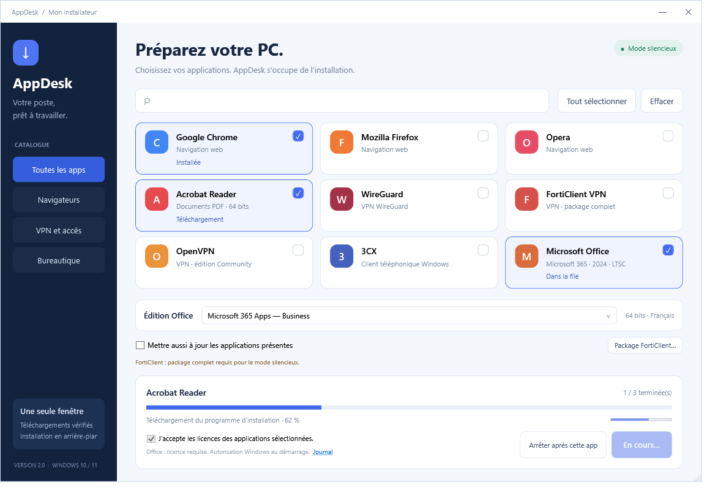

# AppDesk

Installateur Windows personnel, libre et portable, avec sélection d’applications, installation silencieuse et suivi de progression. Licence [MIT](LICENSE).

**État : préversion non signée (`v2.2.0-preview.1`). La candidature SignPath n’a pas été envoyée et aucune signature de production n’a été obtenue.** Dépôt officiel : [nico-TNS/appdesk](https://github.com/nico-TNS/appdesk).



## Fonctionnalités

- Chrome, Firefox, Opera, Acrobat Reader, WireGuard, OpenVPN Community, client Windows 3CX et Office.
- FortiClient VPN téléchargé automatiquement depuis le portail officiel régional Fortinet, avec vérification de sa signature et de sa version. Package local facultatif.
- Choix entre six éditions Office : Microsoft 365 Business/Enterprise, Office 2024 Famille et Petite Entreprise/Professionnel et LTSC 2024 Standard/Professionnel Plus.
- Une fenêtre de suivi, progression globale par applications traitées et activité par application.
- Mise à jour des applications sélectionnées activée par défaut, arrêt après l’application en cours, bilan final intégré et exportable.
- Résolution en ligne du dernier outil Office et de la version disponible du canal choisi. Voir [la politique des sources](docs/SOURCES.md).
- Bouton **Désinstaller Office…** : suppression ciblée de la suite Click-to-Run détectée, confirmation séparée et rapport final. OneNote autonome, Visio et Project ne sont pas ciblés ; les variantes MSI/Store restent à gérer dans Windows.

## Installation et utilisation

Télécharger `MonInstallateur.exe` depuis les [Releases du dépôt officiel](https://github.com/nico-TNS/appdesk/releases). Vérifier les sommes de contrôle et, lorsque la signature sera disponible, sa validité. La première préversion est non signée et peut être bloquée par Windows ; elle ne doit pas être présentée comme approuvée par SignPath.

1. Lancer le fichier sous Windows 10/11 x64 avec .NET Framework 4.8 et WinGet.
2. Cocher les applications, choisir l’édition Office si nécessaire et accepter les licences.
3. Cliquer sur Installer et autoriser Windows à démarrer la file avec les droits requis.

Les applications sont téléchargées à la demande. Le fichier AppDesk ne contient pas leurs installateurs. Les actions ne commencent qu’après votre clic et l’autorisation UAC ; celle-ci n’est pas supprimée. Les licences des éditeurs restent applicables. Aucun redémarrage automatique ni fermeture forcée des applications n’est demandé.

La progression globale mesure les applications traitées, y compris les échecs ; le bilan distingue les résultats. Les pourcentages de téléchargement ne sont affichés que lorsqu’ils sont disponibles. Une animation indique les phases dont la progression précise est inconnue.

## Limites connues

- L’exécutable non signé a été bloqué par le contrôle des applications du poste de développement. Aucun réglage de sécurité n’a été modifié pour le lancer.
- La compilation, les plans silencieux et les simulations passent localement. Les tests réels de l’exécutable et des installations restent à effectuer dans un environnement autorisé. La [CI GitHub Actions](https://github.com/nico-TNS/appdesk/actions/runs/39933286305) a réussi, y compris le test natif des ressources embarquées.
- FortiClient utilise la dernière version VPN x64 complète publiée sur le portail régional officiel. Elle peut différer du canal mondial. Si la source change ou devient inaccessible, une erreur est affichée ; le petit lanceur interactif reste refusé.
- Office nécessite une licence et une activation normales. Une autre édition Click-to-Run présente n’est pas désinstallée automatiquement. Une édition identique x64 peut être actualisée si les mises à jour sont cochées.
- Les profils VPN et les comptes 3CX restent à configurer. Le mode silencieux dépend du comportement de chaque version d’installateur.

## Construire et vérifier

Dans Windows PowerShell 5.1 :

```powershell
.\scripts\Test-Project.ps1
.\scripts\Test-Engine.ps1
.\scripts\Test-Sources.ps1
.\scripts\Build.ps1
```

Le résultat est `dist/MonInstallateur.exe`. La compilation utilise le compilateur C# du .NET Framework installé avec Windows, sans dépendance NuGet ni installateur tiers incorporé. La [CI](.github/workflows/ci.yml) reconstruit et vérifie les mêmes sources sur un runner Windows hébergé par GitHub. Il s’agit d’une compilation vérifiable depuis les sources, pas d’une garantie de binaires identiques octet par octet entre compilateurs.

## Code signing policy

La [politique de signature](CODE_SIGNING.md) décrit les sources autorisées, la compilation, les approbations et l’état de la candidature. Le fournisseur n’a pas encore approuvé AppDesk. La configuration de signature est désactivée par défaut.

Mention prévue **uniquement après acceptation** : “Free code signing provided by [SignPath.io](https://about.signpath.io), certificate by [SignPath Foundation](https://signpath.org).” Elle ne décrit pas un parrainage déjà obtenu.

## Maintenance et contribution

Mainteneur proposé : [@nico-TNS](https://github.com/nico-TNS). Voir [les rôles](MAINTAINERS.md), [le guide de contribution](CONTRIBUTING.md) et [la sécurité](SECURITY.md).

[Confidentialité](PRIVACY.md) · [Désinstallation](docs/UNINSTALL.md) · [Composants tiers](THIRD_PARTY.md) · [Préparer la candidature SignPath](docs/SIGNPATH-ONBOARDING.md)
